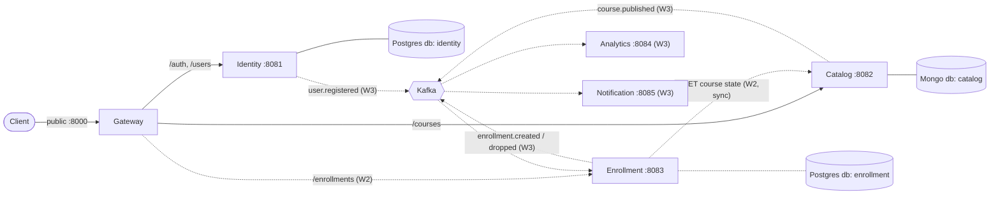

# SmartCourse — Build Plan & Progress

> **Purpose of this file:** single source of truth for where this project is going and where it currently stands, so any session/agent picking this up (fresh context, no chat history) can continue without re-deriving decisions already made. Update the **Progress Log** and checkboxes as work lands — don't let this drift from reality.
>
> **How the owner wants to work (read this before doing anything):**
> - Learner-driven, incremental build — one small vertical slice at a time (e.g. "just linting", "just .env", "just Gin + one route"), never several phases at once.
> - **Guide, don't implement.** The owner writes the code themselves. Explain *what* to do, *why*, library alternatives/trade-offs, and give code snippets to reference — but don't create/edit application files unless explicitly asked to. (This PLAN.md file itself was an explicit exception — the owner asked for it directly.)
> - When reviewing "done" work: actually read the files and run `task check` / build / a quick manual request — don't take "done" at face value, verify it.
> - New to Go (only completed the Tour of Go) — explain idiomatic patterns as they come up (struct tags, error wrapping, `internal/` visibility, etc.), don't assume prior Go-specific knowledge.

---

## 1. What SmartCourse is

Backend for EduCorp's learning platform: course management + publishing workflow, student enrollment, analytics, background/event-driven processing, built to demonstrate Go concurrency (goroutines, channels, worker pools, sync primitives, context propagation) and production-grade observability/reliability patterns.

**Source requirements:** the full original PRD lives in [Requirements.md](Requirements.md) (business goals, functional requirements 1–7, analytics metrics, concurrency expectations, tech stack). It is the source of truth for *what* to build; this file is the source of truth for *how/in what order/where we are*. Read the relevant Requirements.md section before starting any phase, and if the two ever conflict on scope, ask the owner.

**Delivery plan:** [Guidelines.md](Guidelines.md) defines the 3-week milestone structure (each week ends with a mentor review) and the submission requirements (clean repo, README, separate technical design doc). Section 6 follows its weeks.

## 2. Architecture — microservices (switched 2026-10-20, decisions in progress)

The project started as a modular monolith (one `cmd/api` binary, domain packages under `internal/`). On 2026-10-20 the owner switched to **microservices, with MongoDB in the stack**. The monolith was retired in item 1.2: shared helpers moved to `internal/platform`, `internal/user` became the Identity service, and the Postgres course code was deleted (reimplemented on MongoDB in 1.4; the old version is in commit `71333ec` for reference).

**Proposed service map** (coarse-grained; confirm via the open decisions below):

| Service      | Owns                                                               | Storage                            |
| ------------ | ------------------------------------------------------------------ | ---------------------------------- |
| Gateway      | Single public entrypoint: JWT verification, routing, rate limiting | Redis                              |
| Identity     | Users, roles, credentials, issuing JWTs                            | Postgres                           |
| Catalog      | Courses, modules, lessons, publishing workflow, search             | MongoDB (+ MinIO for lesson files) |
| Enrollment   | Enrollments, rules, progress, certificates                         | Postgres                           |
| Analytics    | PRD metrics, computed from events                                  | MongoDB                            |
| Notification | Async delivery via worker pool                                     | Redis (Asynq)                      |

Terminology follows Guidelines.md: a course contains ordered **modules**, a module contains ordered **lessons** (the PRD's "learning assets").

**Service rules** (hold regardless of the open decisions):
1. **Database per service.** A service never reads or writes another service's tables/collections, even when they share a physical Postgres/Mongo instance locally.
2. **Cross-service data:** synchronous calls only where a fresh answer is required; otherwise keep a local read model fed by events.
3. **Side effects go through events** (Kafka, from Week 3). A write that must emit an event uses a **transactional outbox**, so the state change and the event can't diverge.
4. **Consumers are idempotent** (dedupe by event id), so retries are safe.
5. **The gateway authenticates, services authorize.** The gateway verifies the JWT and forwards user id and role; role and ownership rules live in the service that owns the data.
6. **Shared code is a library, never a service,** and holds no business logic. No `pkg/` unless something is genuinely for external reuse.

### Service and data-ownership map (item 1.1, approved by the owner 2026-10-20)


Solid lines are Week 1; dotted lines arrive in the week shown.

| Service      | Owns (source of truth)                                                                               | Store                          | Public routes via gateway                                                          | Week |
| ------------ | ---------------------------------------------------------------------------------------------------- | ------------------------------ | ---------------------------------------------------------------------------------- | ---- |
| Gateway      | Nothing persistent (rate-limit state in Redis, W3)                                                   | —                              | All; the only published port                                                       | 1    |
| Identity     | `users`: id, name, email (unique), role, password_hash, timestamps                                   | Postgres database `identity`   | `POST /auth/register`, `POST /auth/login`, `GET /users/me`, `GET /users/:id`       | 1    |
| Catalog      | `courses` documents: id, instructor_id, title, description, status, modules[ lessons[] ], timestamps | Mongo database `catalog`       | `POST/GET /courses`, `GET/PATCH /courses/:id` (W1); modules, lessons, publish (W2) | 1    |
| Enrollment   | enrollments, progress, outbox, local course replica                                                  | Postgres database `enrollment` | `/enrollments`                                                                     | 2    |
| Analytics    | raw events, metric aggregates                                                                        | Mongo database `analytics`     | `/analytics/*`                                                                     | 3    |
| Notification | notification jobs and delivery log                                                                   | Redis (Asynq)                  | none (event-driven only)                                                           | 3    |

Consequences of database-per-service:
- **No cross-service foreign keys.** `courses.instructor_id` is an opaque reference to an Identity user. The old `courses.instructor_id → users.id` FK goes away; instead `instructor_id` is taken from the verified token, so it always names a real instructor at creation time.
- **One physical Postgres and one Mongo locally, separate databases per service** (`identity`, `enrollment`; `catalog`, `analytics`). Each service has its own credentials/DSN and migrations directory, so splitting onto separate servers later is configuration only.
- **Week 1 has no service-to-service calls**: the gateway talks to Identity and Catalog; they never call each other.
- **Analytics gets user counts from `user.registered` events**, not by querying Identity.
- Services listen on internal ports only in Docker Compose; only the gateway's port is published.

**Access rules (approved 2026-10-20):**
- `GET /users/:id`: any logged-in user gets the public profile (id, name, role); `email` is included only for the user themselves or an admin. Everyone uses `GET /users/me` for their own details.
- Course visibility: students see only `published` courses; instructors see their own courses in any status; admins see everything. In Week 1 every course is a draft, so a student's `GET /courses` is empty.
- Self-registration allows `student` or `instructor` only; admin accounts are seeded, never self-registered.

**Decisions** (A1–A5 confirmed by the owner on 2026-10-20):

| #   | Decision                    | Choice / recommendation                                                                                                                                                                                                          | Needed by |
| --- | --------------------------- | -------------------------------------------------------------------------------------------------------------------------------------------------------------------------------------------------------------------------------- | --------- |
| A1  | Granularity                 | **Decided:** coarse (the 6 services above); split content/search/progress later if needed                                                                                                                                        | Week 1    |
| A2  | Catalog storage             | **Decided:** MongoDB. A course is one document with ordered, embedded modules and lessons (reorder = array update); single-node replica set locally so transactions work                                                         | Week 1    |
| A3  | Service-to-service protocol | **Decided:** REST for now. The gateway reverse-proxies to services; Protobuf only for Kafka schemas (Week 3). Goroutines/channels are not an option here: they only work inside one process, and each service is its own process | Week 1    |
| A4  | Repo layout                 | **Decided:** monorepo, one Go module: `cmd/<service>`, `internal/<service>`, shared `internal/platform`                                                                                                                          | Week 1    |
| A5  | JWT signing                 | **Decided:** HS256 with a secret held only by Identity and the gateway; RS256/JWKS as later hardening                                                                                                                            | Week 1    |
| D1  | Editing a published course  | Draft revision + republish; students see the last published version                                                                                                                                                              | Week 2    |
| D2  | Lesson types                | Video, document, article, external link; no quizzes                                                                                                                                                                              | Week 2    |
| D3  | Lesson files                | Real uploads to MinIO via presigned URLs                                                                                                                                                                                         | Week 2    |
| D4  | Enrollment rules            | Free self-enrollment; optional capacity; optional prerequisite courses; drop and re-enroll with history; no payments or approval                                                                                                 | Week 2    |
| D5  | Completion                  | Student marks lessons complete; all complete → enrollment completed → certificate record                                                                                                                                         | Stretch   |
| D6  | Search                      | MongoDB text index inside Catalog                                                                                                                                                                                                | Week 2    |

## 3. Running conventions (established, keep following these)

- **Config grows with consumers, not ahead of them.** Don't add an env var / config struct field until the code that actually reads it exists in the same change. (Applied so far: `AppEnv` added with the config step itself; `Port` added exactly when Gin needed to bind one.)
- **`.env.example` is committed, `.env` is gitignored.** Real env vars in prod; `.env` is a local-dev-only convenience (`godotenv.Load()` errors are deliberately ignored — see `internal/platform/config/config.go`).
- **One root `.env` for all services; service variables carry the service prefix** (`IDENTITY_PORT`, `IDENTITY_DB_NAME`, later `CATALOG_*`, `GATEWAY_*`). Shared ones are unprefixed (`APP_ENV`, `POSTGRES_*` for the compose server and migrations). Each service declares its own `Config` struct in `internal/<service>/config.go` and loads it with `config.Load[<service>.Config]()`; reusable pieces like `postgres.Config` are nested with `envPrefix:"IDENTITY_DB_"`.
- **Task runner is `go-task`** (`Taskfile.yml`), not Make. Standard tasks: `task tidy`, `task fmt`, `task lint`, `task check` (fmt+lint, run before every commit), `task build` (all services into `bin/`), `task run SERVICE=identity`, `task migrate:up|down|create SERVICE=identity`, `task test`.
- **Postgres databases per service** are created by `deploy/postgres/init/01-create-databases.sql`, which runs only on an empty volume. Adding a database later means adding it there and recreating the volume (`docker compose down -v`), or creating it by hand.
- **Linting via `golangci-lint` v2** (`.golangci.yml` — note v2's schema split `linters:` from `formatters:`; don't paste v1-style flat config from older tutorials).
- **Commit at clean checkpoints** — after a vertical slice works end-to-end and `task check` is clean, not mid-slice.
- **Module path:** `github.com/all2pie/go-smart-course`. Go version: 1.27.1 (satisfies the PRD's "Go 1.25+").

### Domain code conventions (every new `internal/<domain>` package MUST follow these)

File layout per domain: `config.go`, `model.go`, `repository.go`, `service.go`, `handler.go` (role-named files, no entity prefix — the package name already says it). `internal/identity` is the reference implementation; copy its shape. Wiring is explicit in `cmd/<service>/main.go`. When a domain package holds a second entity in the same aggregate (e.g. `Module` inside the catalog), put it in `<entity>_model.go` / `_repository.go` / `_service.go` / `_handler.go`: the `Repository` interface, `Service` and `Handler` stay single (aggregate-level) and just gain methods, so the wiring in `main.go` doesn't change.

1. **Errors: return `errs` sentinels, never write HTTP status codes in domain code.**
   - Declare domain errors as package-level sentinels: `var ErrNotFound = errs.New(errs.NotFound, "course not found")`. Kinds: `errs.NotFound`, `errs.Invalid`, `errs.Conflict`, `errs.Internal`.
   - Repositories translate ORM errors into these (e.g. `gorm.ErrRecordNotFound` → the domain's `ErrNotFound`; `gorm.ErrDuplicatedKey` → an `errs.Conflict` sentinel like `identity.ErrEmailTaken` — `TranslateError: true` is set in `postgres.Connect`, so never inspect pgx/`23505` directly); unknown errors are wrapped with `fmt.Errorf("doing x: %w", err)` and surface as a generic 500.
   - Services/handlers just `return err` — no per-handler `errors.Is` ladders. New status mapping goes in `web.statusFor` once, not in each domain.
   - `internal/platform/errs` must stay free of Gin/HTTP imports so workers/Kafka consumers can reuse it.
2. **Handlers: `func (h *Handler) x(c *gin.Context) error`, registered via `web.Wrap(h.x)`.** Decode JSON bodies with `web.Bind[reqType](c)` (returns an `errs.Invalid` error on bad input). Success paths write their own `c.JSON(...)` and `return nil`. Keep the per-domain request struct (with `binding` tags) separate from the service's input struct — don't put Gin tags on service types.
3. **Postgres models embed `postgres.Model`** (`ID uuid`, `CreatedAt`, `UpdatedAt`) instead of redeclaring those columns; only add domain-specific fields. Schema still comes from a `golang-migrate` SQL migration in `migrations/<service>/`, never `AutoMigrate`.
4. **Partial updates and lists.**
   - `PATCH /<things>/:id` takes an update input of **pointer fields** (nil = leave unchanged, pointer to `""` = clear). The service rejects an all-nil update with an `errs.Invalid` sentinel; the repository applies a `map[string]any` via `Updates` with `clause.Returning{}` and treats `RowsAffected == 0` as not-found. Server-controlled columns (e.g. `status`) are never in the update struct.
   - `GET /<things>` is paginated with `limit`/`offset`. Defaults and the max are applied in the **service** (default 20, max 100); the handler's `binding` tags reject out-of-range values. Responses are `{items, total, limit, offset}` with `items` always a non-nil slice (`[]`, never `null`); order by `created_at DESC, id` for stable pages. Query params are bound with `web.BindQuery[T]`.
   - Gin's query/form binding cannot decode `uuid.UUID`/`*uuid.UUID` by default (it is a `[16]byte`, so Gin takes its array branch and expects 16 repeated values). Opt in to `UnmarshalText` with the tag option: `form:"instructor_id,parser=encoding.TextUnmarshaler"` on a `*uuid.UUID` field (absent param stays `nil`; a malformed value is a binding error → 400). JSON bodies are unaffected.
5. **Deliberately NOT doing:** a generic `Repository[T]` CRUD base (leaks GORM, forces every entity into one shape), reflection-heavy frameworks, DI containers (explicit constructor wiring in `cmd/<service>/main.go` is the pattern).

## 4. Tech stack — decided vs. deferred

### Decided / in use
| Concern             | Choice                                          | Why (brief — full reasoning was given in chat, ask owner if it needs restating)                                                       |
| ------------------- | ----------------------------------------------- | ------------------------------------------------------------------------------------------------------------------------------------- |
| HTTP framework      | Gin                                             | Given in original PRD wishlist                                                                                                        |
| .env loading        | `joho/godotenv`                                 | Minimal, single-purpose                                                                                                               |
| Env → struct config | `caarlos0/env/v11`                              | Zero-dep, struct-tag based, pairs with godotenv                                                                                       |
| Linting             | `golangci-lint` v2                              | Aggregates `govet`, `staticcheck`, `errcheck`, `unused`, `ineffassign` (via `default: standard`) + `misspell`, `unconvert`, `unparam` |
| Formatting          | `gofmt` + `goimports` (via `golangci-lint fmt`) | Standard Go formatting + import grouping                                                                                              |
| Task runner         | `go-task` (Taskfile)                            | Chosen over Make/plain scripts by owner                                                                                               |

### Decided in principle, not yet implemented
| Concern              | Choice                                      | Notes                                                                                                                                                                                                                                      |
| -------------------- | ------------------------------------------- | ------------------------------------------------------------------------------------------------------------------------------------------------------------------------------------------------------------------------------------------ |
| Relational DB        | PostgreSQL + GORM                           | Identity and Enrollment: relational, transactional, uniqueness constraints                                                                                                                                                                 |
| Document DB          | MongoDB                                     | Catalog (pending A2) and Analytics. Local dev runs a single-node replica set, which Mongo transactions require                                                                                                                             |
| Object storage       | MinIO (S3-compatible)                       | Lesson files (pending D3)                                                                                                                                                                                                                  |
| Auth                 | JWT (`golang-jwt/jwt/v5`) + bcrypt          | Week 1; signing pending A5                                                                                                                                                                                                                 |
| Cache/queues backing | Redis                                       | Not yet wired                                                                                                                                                                                                                              |
| Event streaming      | Kafka + Confluent Schema Registry           | Not yet wired                                                                                                                                                                                                                              |
| Durable workflows    | Temporal (Go SDK)                           | For the multi-step course-publish and enrollment sagas specifically                                                                                                                                                                        |
| Background jobs      | Asynq (Redis-based)                         | For simple fire-and-forget jobs (notifications, analytics bumps) — **not** RabbitMQ+native workers, redundant given Redis is already in-stack. Guidelines.md says "Celery", which is Python-only; Asynq is the Go equivalent the PRD lists |
| Kafka client         | `twmb/franz-go`                             | Pure Go, no CGO, chosen over `confluent-kafka-go` (CGO/librdkafka) and `segmentio/kafka-go` (less actively maintained)                                                                                                                     |
| Logging              | stdlib `log/slog`                           | Not yet wired                                                                                                                                                                                                                              |
| Observability        | OpenTelemetry + Prometheus/Grafana + Jaeger | Not yet wired                                                                                                                                                                                                                              |
| Validation           | `go-playground/validator`                   | In use through Gin's `binding` tags                                                                                                                                                                                                        |
| Migrations           | `golang-migrate/migrate`                    | In use for Postgres; one migrations directory per service from Week 1. Do NOT rely on GORM `AutoMigrate`                                                                                                                                   |

### Open architectural question — flagged, not resolved
The PRD explicitly wants hand-rolled goroutines/channels/worker-pools/sync primitives *demonstrated*, but Asynq/Temporal would otherwise implement that for you. **Decision needed before background processing work starts:** which specific workloads get a hand-rolled worker pool (learning exercise) vs. which lean on Asynq/Temporal (reliability, no reinvention). Suggested split floated in chat: Temporal for the stateful multi-step workflows (publish, enrollment saga), hand-rolled worker pools for simpler high-volume jobs (e.g. notification dispatch) where the concurrency patterns are the point. **Not yet decided — resolve at the start of Week 3 (item 3.3).**

## 5. Progress log

| Date       | Milestone                                                                                                                                                                                                                                                                                                                                                 | Commit                                                                                 |
| ---------- | --------------------------------------------------------------------------------------------------------------------------------------------------------------------------------------------------------------------------------------------------------------------------------------------------------------------------------------------------------- | -------------------------------------------------------------------------------------- |
| 2026-09-07 | Project scaffolded: `cmd/api`, `internal/config`, module init                                                                                                                                                                                                                                                                                             | `6d02497`                                                                              |
| 2026-09-07 | Linting (`golangci-lint` v2) + formatting + Taskfile set up                                                                                                                                                                                                                                                                                               | `6d02497`                                                                              |
| 2026-09-07 | `.env` support end-to-end (godotenv + caarlos0/env), trimmed to only `APP_ENV` at the time                                                                                                                                                                                                                                                                | `6d02497`                                                                              |
| 2026-09-14 | Gin HTTP server added: `internal/server`, `GET /ping`, `Port` config field added (config-grows-with-consumer applied), `gin.SetMode` driven by `AppEnv`, trusted proxies disabled                                                                                                                                                                         | `ef3195a`                                                                              |
| 2026-09-21 | Postgres config fields (`DB_HOST`/`DB_PORT`/`DB_USER`/`DB_PASSWORD`/`DB_NAME`) added to `Config` + `.env.example`                                                                                                                                                                                                                                         | `0e5dc72`                                                                              |
| 2026-09-21 | `docker-compose.yml` (local Postgres) + `internal/db` package opening the GORM connection + `GET /health/db` route                                                                                                                                                                                                                                        | `0e5dc72`                                                                              |
| 2026-09-21 | `task infra:up`/`infra:down` Taskfile tasks for Docker Compose                                                                                                                                                                                                                                                                                            | `8f73fb6`                                                                              |
| 2026-09-29 | `golang-migrate` wired (`task migrate:up`/`down`/`create`), first migration: `users` table (id, name, email, role CHECK-constrained, timestamps)                                                                                                                                                                                                          | `8c61a6a`                                                                              |
| 2026-09-29 | `internal/user` domain package (model/repository/service/handler), `POST /users` + `GET /users/:id` wired into `server.go`, create+fetch round-trip verified against real Postgres                                                                                                                                                                        | `5b433b8`                                                                              |
| 2026-09-30 | Boilerplate-reduction refactor: `internal/errs` (error kinds), `internal/web` (`Wrap`, `Bind[T]`, `WriteError`), `db.Model` embedding; `internal/user` migrated to them; conventions recorded in section 3                                                                                                                                                | `5b433b8`                                                                              |
| 2026-09-30 | Duplicate email now returns 409 (`user.ErrEmailTaken`, `errs.Conflict`) via GORM `TranslateError: true`; verified against Postgres                                                                                                                                                                                                                        | `5b433b8`                                                                              |
| 2026-10-20 | Phase 3 slice 1: `courses` table migration (instructor_id FK, status draft/ready), `internal/course` (model/repository/service/handler), `POST /courses` + `GET /courses/:id`; FK violation → 400 via `TranslateError`; verified against Postgres                                                                                                         | `2f08052`                                                                              |
| 2026-10-20 | Phase 3 slice 2: `PATCH /courses/:id` (partial update of title/description, `status` not client-editable) and `GET /courses` (limit/offset pagination, optional `instructor_id` filter, `{items,total,limit,offset}`); `web.BindQuery[T]` added; verified against Postgres, `task check` clean                                                            | `71333ec`                                                                              |
| 2026-10-20 | Phase 3 slice 3: `modules` table migration (course_id FK ON DELETE CASCADE, `position`, UNIQUE(course_id, position)), `POST /courses/:id/modules` + `GET /courses/:id/modules` (ordered by position); position assigned server-side in a transaction that row-locks the parent course; 20 concurrent creates verified gap-free (1..N); `task check` clean | *(reverted 2026-10-20, never committed: content structure moves to MongoDB in Week 2)* |
| 2026-10-20 | Week 1 items 1.2 + 1.3: monolith retired; shared code moved to `internal/platform` (`config.Load[T]`, `postgres.Connect`/`Model`, `errs`, `web` + `NewRouter`); Identity service (`cmd/identity`, `internal/identity`, port 8081, database `identity`, `migrations/identity`); compose creates per-service databases; prefixed env vars; Taskfile takes `SERVICE=`. Verified: migrate, ping, health, create 201, duplicate 409, bad role 400, get 200/400/404; `task check` clean | *(this commit)* |

**Current repo state:**
```
cmd/identity/main.go                — wiring: config.Load → postgres.Connect → web.NewRouter → identity routes
internal/platform/config/           — Load[T]() (godotenv + caarlos0/env)
internal/platform/postgres/         — Config (nested via envPrefix), Connect (GORM, TranslateError), Model
internal/platform/errs/             — transport-agnostic error kinds (NotFound/Invalid/Conflict/Internal)
internal/platform/web/              — NewRouter (+GET /ping), Wrap, Bind[T], BindQuery[T], WriteError
internal/identity/                  — config.go, model.go, repository.go, service.go, handler.go (POST /users, GET /users/:id)
migrations/identity/                — 000001_create_users_table (up/down)
deploy/postgres/init/               — creates databases identity, enrollment on first start
docker-compose.yml                  — local Postgres (smartcourse-postgres)
.golangci.yml, Taskfile.yml, .gitignore, .env.example — all in place
```
One service (Identity) runs on port 8081 against its own database. No
course endpoints until Catalog lands (1.4); no gateway until 1.5.

## 6. Roadmap — organized by the 3-week plan in [Guidelines.md](Guidelines.md)

Each week ends with a mentor review: submit, discuss feedback, refine, then move on. Work inside a week still lands as small verified slices.

### Done before the week plan (monolith foundation, reused in Week 1)
- [x] Tooling: golangci-lint v2, Taskfile, `.env` config
- [x] Gin server + health routes
- [x] Postgres + GORM + golang-migrate; `users` and `courses` tables
- [x] User create/get; course create/get/update/list; shared `errs`/`web`/`db` helpers and the conventions in section 3
- Reverted: a Postgres modules prototype (create/list). Content structure is Week 2 scope and moves to MongoDB (A2).

### 🟢 Week 1 — Foundation + Core Services
*Guidelines scope: system design and setup; user & course CRUD; role handling (student/instructor). Deliverables: service structure defined, DB schemas created, basic APIs working, local setup ready.*

- [x] **1.1 Finalize the architecture:** A1–A5 decided; service and data-ownership map and access rules approved (section 2).
- [x] **1.2 Restructure into services:** shared code in `internal/platform` (config, postgres, errs, web); one `cmd/<service>` per service, each with its own config, port and database/migrations. Monolith (`cmd/api`, `internal/server`, Postgres course code) retired.
- [x] **1.3 Identity service:** users and roles (ported from `internal/user`). Credentials and the access rules arrive with auth in 1.6.
- [ ] **1.4 Catalog service:** course CRUD reimplemented on MongoDB (A2); the retired Postgres version in commit `71333ec` is the behavioural reference.
- [ ] **1.5 API gateway:** single public port, reverse-proxies `/auth`, `/users` and `/courses` to the services, request-id propagation.
- [ ] **1.6 Auth + role handling:** register/login with bcrypt, access-token JWT issued by Identity and verified at the gateway, user id and role forwarded as headers. Catalog enforces "only instructors create courses" and "only the owning instructor or an admin edits"; `instructor_id` comes from the token, not the request body.
- [ ] **1.7 Local setup:** Docker Compose for infra (Postgres, MongoDB) and all services; one command to start everything; per-service `.env.example`.
- [ ] **1.8 Docs skeleton:** README (overview, architecture diagram, setup, API overview, tech stack) and a technical design doc (service breakdown, data/event flow, decisions, tradeoffs). Started now, extended every week.
- [ ] **1.9 Tests for core rules:** unit tests for role/ownership checks and validation in each service.
- [ ] **Week 1 mentor review.**

### 🟡 Week 2 — Enrollment + Publishing Workflow
*Guidelines scope: enrollment with duplicate handling and basic validations; Temporal publishing workflow; content structure (modules/lessons). Deliverables: reliable enrollment, workflow orchestration, course state transitions.*

- [ ] **2.0 Decide D1–D4 and D6** (section 2).
- [ ] **2.1 Content structure:** modules and lessons embedded in the course document: create, list, rename, delete, reorder.
- [ ] **2.2 Course state machine:** `draft → publishing → published | publish_failed`, `published → archived`; invalid transitions rejected.
- [ ] **2.3 Temporal publish workflow** (PRD §2 and the §7 concurrency showcase): stage 1 checks in parallel (validate metadata, verify lessons), then stage 2 effects in parallel (search index, cache refresh, analytics init), then mark `published`. Idempotent activities, retries, partial-failure handling; goroutines, WaitGroup, channels and `context` cancellation demonstrated.
- [ ] **2.4 Enrollment service:** enroll, drop, history; duplicate handling (one active enrollment per student and course, plus an `Idempotency-Key` header); validations (course published, capacity, prerequisites); progress initialized in the same transaction.
- [ ] **2.5 Enrollment → Catalog lookup:** a synchronous call for course state in Week 2, replaced by an event-fed local replica in Week 3 (3.2).
- [ ] **2.6 Tests:** concurrent enroll requests (duplicate and capacity races); workflow tests with Temporal's test suite.
- [ ] **Week 2 mentor review.**

### 🔴 Week 3 — Event-Driven System + Observability
*Guidelines scope: Kafka events; background workers; basic analytics; logs, tracing, metrics. Deliverables: event-driven flows, analytics pipeline, monitoring and tracing.*

- [ ] **3.1 Kafka + Schema Registry:** topics and Protobuf schemas for `course.published`, `enrollment.created`, `enrollment.dropped`; transactional outbox + relay in Catalog and Enrollment; client `twmb/franz-go`.
- [ ] **3.2 Event consumers:** Enrollment's local course replica fed by `course.published` (replaces 2.5); idempotent consumers; dead-letter topic for poison messages.
- [ ] **3.3 Background workers + Notification service:** Asynq in place of Guidelines' "Celery"; resolve the Asynq vs hand-rolled split (section 4); bounded worker pool with job queue, graceful shutdown, retries, backpressure.
- [ ] **3.4 Analytics service (MongoDB):** consumes events; basic metrics: total students/instructors, courses published, new enrollments over time, most popular courses, failed events; counters with `sync/atomic` / `sync.Mutex`.
- [ ] **3.5 Redis:** cache for course reads (with a `sync.RWMutex` in-memory layer) and the gateway rate limiter.
- [ ] **3.6 Observability:** `log/slog` structured logs with request/trace ids; OpenTelemetry traces across gateway → services → Kafka → consumers, exported to Jaeger; Prometheus metrics and a Grafana dashboard.
- [ ] **3.7 Final deliverables** (Guidelines §6): README and design doc complete, key workflows working end-to-end, `go test -race` clean across concurrency code.
- [ ] **Week 3 mentor review.**

### Stretch — PRD items beyond the 3-week scope
- Lesson progress updates, course completion and certificates (D5), which unlock the completion-rate, average-time-to-complete and average-courses-per-student metrics
- A dedicated search engine, if MongoDB text search proves limiting
- JWT refresh tokens; RS256/JWKS
- Hardening: migration review, stricter lint, coverage targets

## 7. How to resume this project in a fresh session

1. Read this file in full first, then skim [Requirements.md](Requirements.md) (the PRD) and [Guidelines.md](Guidelines.md) (the 3-week plan) for the sections matching the next roadmap item.
2. Run `git log --oneline` and `find . -type f` (excluding `.git`) to confirm reality matches section 5's stated state — **the code is the source of truth if this file and the code ever disagree.**
3. Check the roadmap in section 6 for the next unchecked item in the current week — that's the next slice, not the whole week at once.
4. Re-read section "How the owner wants to work" at the top before doing anything.
5. After landing a slice: verify it (`task check`, build, a manual request/test), update section 5's progress log and tick the relevant box(es) in section 6, then stop and hand back — don't cascade into the next phase unprompted.
