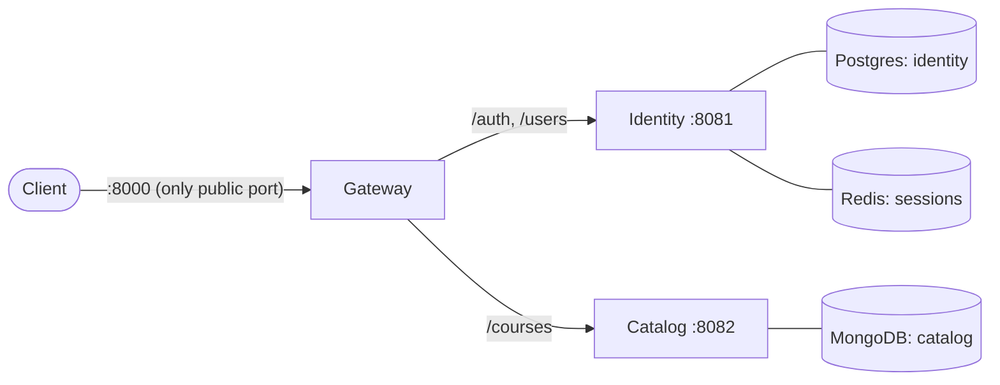

# SmartCourse

Backend for EduCorp's learning platform: course management and publishing, student enrollment, analytics and event-driven processing. Built in Go as a set of microservices behind an API gateway.

> **Status:** Week 1 of 3 (foundation + core services). See [PLAN.md](PLAN.md) for the roadmap and [docs/design.md](docs/design.md) for the technical design.

## Architecture



| Service  | Responsibility                                                      | Storage         |
| -------- | ------------------------------------------------------------------- | --------------- |
| Gateway  | Single entrypoint: JWT verification, routing, request IDs, API docs | —               |
| Identity | Users, roles, passwords, login sessions (access + refresh tokens)   | Postgres, Redis |
| Catalog  | Courses, visibility and ownership rules                             | MongoDB         |

Enrollment, Analytics and Notification services arrive in Weeks 2–3.

## Quick start

Prerequisites: Docker (with Compose v2) and [go-task](https://taskfile.dev).

```bash
cp .env.example .env
# Fill in .env:
#   POSTGRES_PASSWORD and IDENTITY_DB_PASSWORD  (same value)
#   JWT_SECRET                                  (openssl rand -base64 48)
task up          # builds images, runs migrations, starts everything
```

- API docs (Swagger UI): <http://localhost:8000/docs>
- OpenAPI contract: <http://localhost:8000/openapi.yaml> (generated from the Go operations into [api/openapi.yaml](api/openapi.yaml) by `task api:gen`)
- Errors are [RFC 9457](https://www.rfc-editor.org/rfc/rfc9457) problem details (`application/problem+json`): malformed JSON is a 400, failed validation a 422 listing the fields in `errors`.

Try it:

```bash
G=http://localhost:8000
curl -s -X POST $G/auth/register -H 'Content-Type: application/json' \
  -d '{"name":"Ivy","email":"ivy@example.com","password":"instructorpass1","role":"instructor"}'

TOKEN=$(curl -s -X POST $G/auth/login -H 'Content-Type: application/json' \
  -d '{"email":"ivy@example.com","password":"instructorpass1"}' | jq -r .access_token)

curl -s -X POST $G/courses -H "Authorization: Bearer $TOKEN" \
  -H 'Content-Type: application/json' -d '{"title":"Go 101"}'
```

Admin accounts can't self-register. Create one (needs Go on the host):

```bash
task admin:create -- -email admin@example.com -name "Site Admin"   # prompts for the password
```

Stop everything with `task down`; follow logs with `task logs -- gateway identity`.

## Developing on the host

Run only the databases in Docker and the services with `go run`:

```bash
task infra:up
task migrate:up SERVICE=identity
task migrate:up SERVICE=catalog
task run SERVICE=identity    # and catalog, gateway in other terminals
```

Extra prerequisites: Go 1.27+, golangci-lint v2, and the migrate CLI built with both drivers:
`go install -tags 'postgres mongodb' github.com/golang-migrate/migrate/v4/cmd/migrate@latest`.

| Task                                           | What it does                                                   |
| ---------------------------------------------- | -------------------------------------------------------------- |
| `task up` / `task down` / `task logs`          | Whole stack in Docker                                          |
| `task infra:up` / `task infra:down`            | Only Postgres, MongoDB, Redis                                  |
| `task run SERVICE=<name>`                      | Run one service on the host                                    |
| `task build`                                   | Build all binaries into `bin/`                                 |
| `task migrate:up\|down\|create SERVICE=<name>` | Database migrations (SQL for Postgres, JSON for Mongo)         |
| `task check`                                   | Format + lint (run before every commit)                        |
| `task api:gen` / `task api:check`              | Regenerate the OpenAPI contract / fail if stale or lint errors |
| `task api:lint`                                | Lint the OpenAPI contract                                      |
| `task test`                                    | Unit tests (race detector, no dependencies)                    |
| `task test:integration`                        | Repository tests on real databases (testcontainers)            |
| `task test:e2e`                                | End-to-end + OpenAPI contract tests (after `task up`)          |
| `task admin:create -- -email ...`              | Create an admin account                                        |

## API overview

| Method | Path             | Auth   | Description                               |
| ------ | ---------------- | ------ | ----------------------------------------- |
| POST   | `/auth/register` | public | Register a student or instructor          |
| POST   | `/auth/login`    | public | Email + password → access + refresh token |
| POST   | `/auth/refresh`  | public | Rotate the refresh token, get a new pair  |
| POST   | `/auth/logout`   | public | End the session                           |
| GET    | `/users/me`      | bearer | Own profile                               |
| GET    | `/users/{id}`    | bearer | Profile (email only for self or admin)    |
| POST   | `/courses`       | bearer | Create a draft course (instructors)       |
| GET    | `/courses`       | bearer | List visible courses (paginated)          |
| GET    | `/courses/{id}`  | bearer | Get a course                              |
| PATCH  | `/courses/{id}`  | bearer | Update title/description (owner or admin) |

Full request/response schemas: [api/openapi.yaml](api/openapi.yaml).

## Project layout

```
api/                   Generated OpenAPI contract (embedded and served by the gateway)
cmd/<service>/         Entrypoints: gateway, identity, catalog, identity-admin, openapi (spec generator)
internal/<service>/    Service code: config, model, repository, service, handler, policy
internal/platform/     Shared libraries: config, postgres, mongodb, redisdb, auth, errs, problem, httpapi, web
migrations/<service>/  golang-migrate files per database
test/e2e/              End-to-end + contract tests against the running stack
deploy/                Local infra bootstrap (Postgres databases)
docs/                  Technical design
```

## Tech stack

Go 1.27 · Gin + Huma v2 · PostgreSQL 16 + GORM · MongoDB 8 (official driver v2) · Redis 8 (go-redis v9) · JWT (golang-jwt v5) + bcrypt · golang-migrate · Docker Compose · go-task · golangci-lint v2 · OpenAPI 3.1 + Swagger UI.

Planned: Temporal (publish workflow), Kafka (events), Asynq (background jobs), OpenTelemetry + Prometheus/Grafana + Jaeger.

## Documentation

- [docs/design.md](docs/design.md) — architecture, data model, auth design, decisions and tradeoffs
- [PLAN.md](PLAN.md) — roadmap, open decisions, progress
- [AGENTS.md](AGENTS.md) — conventions and workflow for contributors and AI agents
- [Requirements.md](Requirements.md) — product requirements; [Guidelines.md](Guidelines.md) — delivery plan
