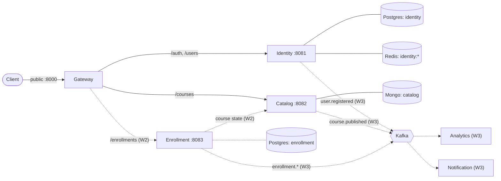
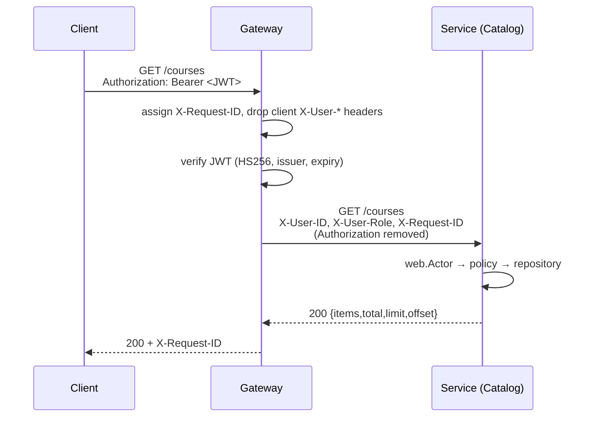
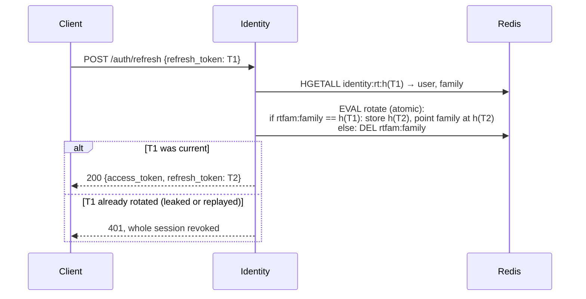

# SmartCourse — Technical Design

Status: Week 1 (foundation + core services). This document describes what is built and why; the roadmap lives in [PLAN.md](../PLAN.md), the API contract in [api/openapi.yaml](../api/openapi.yaml).

## 1. Goals and scope

SmartCourse is the backend for EduCorp's learning platform ([Requirements.md](../Requirements.md)): course authoring and publishing, enrollment, analytics and event-driven background processing. Beyond features, the project is meant to demonstrate production patterns in Go: service boundaries, secure authentication, idempotency, concurrency primitives, and observability.

Week 1 delivers the foundation: service structure, identity and authentication, course CRUD with role-based access, and a one-command local environment.

## 2. Architecture



Solid lines exist today; dotted lines arrive in the week shown.

### 2.1 Services

| Service      | Owns                                                           | Store                                   | Status |
| ------------ | -------------------------------------------------------------- | --------------------------------------- | ------ |
| Gateway      | Nothing persistent; routing, authentication, request IDs, docs | —                                       | Built  |
| Identity     | Users, roles, password hashes, login sessions                  | Postgres `identity`, Redis `identity:*` | Built  |
| Catalog      | Courses (later modules, lessons, publishing)                   | MongoDB `catalog`                       | Built  |
| Enrollment   | Enrollments, progress, local course replica                    | Postgres `enrollment`                   | Week 2 |
| Analytics    | Metrics computed from events                                   | MongoDB `analytics`                     | Week 3 |
| Notification | Asynchronous delivery                                          | Redis (Asynq)                           | Week 3 |

### 2.2 Service rules

1. **Database per service.** A service never touches another service's tables, collections or Redis keys, even when they share a server locally.
2. **No cross-service foreign keys.** `courses.instructor_id` is an opaque reference to an Identity user, taken from the verified token at creation.
3. **The gateway authenticates, services authorize.** Role and ownership rules live in the service that owns the data.
4. **Cross-service data:** synchronous calls only when a fresh answer is required; otherwise an event-fed local read model (Week 3).
5. **Side effects go through events** with a transactional outbox; consumers are idempotent (Week 3).
6. **Shared code is a library, never a service,** and holds no business logic (`internal/platform`).

### 2.3 Code structure

One Go module, one binary per service (`cmd/<service>`), service code in `internal/<service>`, shared libraries in `internal/platform`. Inside a service the layers are:

```
handler (Gin, request/response types)  →  service (business rules, policy.go)  →  repository / store (persistence)
```

Handlers return errors instead of writing them; `web.Wrap` maps transport-agnostic error kinds (`errs.NotFound`, `Invalid`, `Conflict`, `Unauthenticated`, `Forbidden`) to HTTP statuses in one place, and unknown errors become a generic 500 so internals never leak.

## 3. Request flow



- **Secure by default:** only `POST /auth/{register,login,refresh,logout}`, `/ping`, `/docs` and `/openapi.yaml` are public. Every other proxied route sits behind `Authenticate`; a new route is protected unless explicitly added to the public list.
- **Header trust:** services trust `X-User-ID` / `X-User-Role` because only the gateway can reach them (only its port is published) and it always strips client-sent copies. Calling a service directly without these headers returns 401.
- **Request IDs:** a client-sent `X-Request-ID` is kept only if it is a UUID (so arbitrary strings never reach logs); otherwise one is generated. It is forwarded and echoed.
- **Upstream failure:** if a service is unreachable the gateway returns `502 {"error":"upstream unavailable"}`.

## 4. Identity and sessions

### 4.1 Tokens

| Token   | Format                                                | Lifetime | Stored                                       |
| ------- | ----------------------------------------------------- | -------- | -------------------------------------------- |
| Access  | JWT, HS256, claims `sub`, `role`, `iss`, `iat`, `exp` | 15 min   | Nowhere (stateless, verified by the gateway) |
| Refresh | 130-bit random string (`crypto/rand.Text`)            | 7 days   | Redis, as a SHA-256 hash only                |

The gateway rejects tokens with the wrong algorithm, signature, issuer, or a missing/past expiry. The HMAC secret (`JWT_SECRET`, ≥ 32 bytes) is held only by Identity and the gateway. Because refresh re-reads the user, role changes take effect within one access-token lifetime.

### 4.2 Refresh rotation and reuse detection

Every login starts a **family** (one session). Redis holds:

```
identity:rt:<sha256(token)>   HASH {user, family}   one per issued token, immutable, TTL 7d
identity:rtfam:<family>       STRING <sha256>       the family's only currently valid token, TTL 7d
```



- Rotation is a single Lua script, so two concurrent refreshes of the same token cannot both succeed (verified: 5 parallel requests → exactly one 200).
- Presenting any non-current token of a family deletes the family pointer, revoking the session for both the attacker and the legitimate client (OAuth 2.0 Security BCP refresh-token reuse detection).
- Logout deletes the family pointer and is idempotent.
- Expired tokens disappear via Redis TTLs; there is no cleanup job. Redis runs with AOF persistence so a restart does not log users out.

**Tradeoff:** a client that fires parallel refreshes with the same token is treated as a replay and logged out. A short grace window for the previous token would relax this if a browser client needs it.

### 4.3 Credentials

- Passwords are bcrypt-hashed (default cost); accepted length is 8 characters to 72 bytes (bcrypt's input limit).
- Emails are trimmed and lowercased before storage and lookup.
- Login returns the same `401 invalid email or password` for unknown emails and wrong passwords, and runs a bcrypt comparison against a dummy hash for unknown emails, so response timing doesn't reveal which accounts exist.
- Self-registration allows `student` and `instructor` only. Admins are created by an operator with `cmd/identity-admin` (`task admin:create`), which reads the password without echo (or from stdin) and is idempotent; admin credentials never live in env vars, migrations or an HTTP endpoint.

## 5. Authorization

| Rule                                                                           | Where                |
| ------------------------------------------------------------------------------ | -------------------- |
| Only instructors create courses                                                | `catalog/service.go` |
| Students see published courses; instructors also see their own; admins see all | `catalog/policy.go`  |
| Only the owning instructor or an admin edits a course                          | `catalog/policy.go`  |
| `email` visible only to the user themselves or an admin                        | `identity/policy.go` |
| Self-registration only as student or instructor                                | `identity/policy.go` |

A resource the caller may not see returns **404** (its existence isn't revealed); one they can see but not change returns **403**. Policies are small pure functions so they are trivially unit-testable.

## 6. Data model

### 6.1 Identity (Postgres `identity`)

```sql
users (
  id            UUID PRIMARY KEY DEFAULT gen_random_uuid(),
  name          VARCHAR(255) NOT NULL,
  email         VARCHAR(255) NOT NULL UNIQUE,
  role          VARCHAR(50)  NOT NULL CHECK (role IN ('student','instructor','admin')),
  password_hash TEXT NOT NULL,
  created_at    TIMESTAMPTZ NOT NULL, updated_at TIMESTAMPTZ NOT NULL
)
```

Timestamps are stored in UTC at microsecond precision (Postgres' resolution) so API responses match stored values.

### 6.2 Catalog (MongoDB `catalog.courses`)

```json
{ "_id": "uuid-string", "instructor_id": "uuid-string", "title": "Go 101", "description": "",
  "status": "draft", "created_at": ISODate, "updated_at": ISODate }
```

- IDs are UUIDs everywhere; Mongo stores them as canonical strings (a codec in `internal/platform/mongodb`) so they match other services and read cleanly in `mongosh`.
- Indexes: `{status, created_at:-1, _id}` (student lists) and `{instructor_id, created_at:-1, _id}` (instructor lists). Lists sort by `created_at DESC, _id` for stable pagination.
- In Week 2 modules and lessons are embedded as ordered arrays (reorder = array update).

### 6.3 Redis

Keys are namespaced by owning service (`identity:` today; `gateway:` for rate limiting later). See §4.2.

## 7. Cross-cutting concerns

- **Configuration:** environment variables parsed into a per-service struct (`config.Load[T]`); service variables are prefixed (`IDENTITY_DB_NAME`), shared ones are not (`JWT_SECRET`). A root `.env` is loaded for local development only.
- **Validation:** Gin binding tags at the edge, domain rules in services.
- **Pagination:** `limit`/`offset`, default 20, max 100, response `{items,total,limit,offset}` with `items` never `null`.
- **Secrets in logs:** GORM logs SQL with placeholders only; tokens and password hashes are never logged or serialized.
- **Health:** every service exposes `/ping`; Identity and Catalog also expose `/health/<dependency>` (`/health/db`, and `/health/redis` on Identity).
- **API contract:** [api/openapi.yaml](../api/openapi.yaml) (OpenAPI 3.1) is hand-written spec-first, linted with Redocly (`task api:lint`), and served by the gateway at `/openapi.yaml` with Swagger UI at `/docs` (UI assets load from the unpkg CDN, pinned version).

## 8. Local environment and delivery

- `docker-compose.yml` runs Postgres 16, MongoDB 8 (single-node replica set, needed for transactions), Redis 8 (AOF), and, under the `app` profile, the services.
- One multi-stage `Dockerfile` builds any service (`--build-arg SERVICE=...`) into a static binary on distroless `nonroot` (17–37 MB images). `.env` is never copied into images.
- **Migrations run as one-shot jobs** (`migrate/migrate`) that must succeed before their service starts, mirroring the production practice of a separate pipeline step rather than migrating on service start. Schema changes should follow expand/contract so old and new versions can run side by side.
- Only the gateway's port is published; database ports bind to `127.0.0.1` for local tools.

## 9. Decisions and tradeoffs

| #   | Decision             | Choice                                                       | Why / tradeoff                                                                |
| --- | -------------------- | ------------------------------------------------------------ | ----------------------------------------------------------------------------- |
| A1  | Granularity          | 6 coarse services                                            | Clear ownership without nano-services; can split later                        |
| A2  | Catalog store        | MongoDB, course = one document with embedded modules/lessons | Natural aggregate, atomic reorder; cross-course queries need indexes          |
| A3  | Service protocol     | REST via gateway reverse proxy                               | Simple, debuggable; Protobuf only for Kafka events (W3)                       |
| A4  | Repo layout          | Monorepo, one module                                         | Shared tooling and atomic refactors; services still deploy independently      |
| A5  | JWT signing          | HS256, secret only in Identity + gateway                     | Simple; RS256/JWKS is the hardening path if more verifiers appear             |
| A6  | Caller identity      | Gateway forwards `X-User-*`; services trust it               | No token code in services; relies on network isolation (services unpublished) |
| A7  | Mongo client / IDs   | Official driver v2, UUID strings                             | No ODM magic; consistent IDs across stores at a small size cost               |
| A8  | Mongo migrations     | golang-migrate JSON commands                                 | One tool and workflow for all databases; versioned, reviewable                |
| A9  | Per-service DB users | Deferred                                                     | Ownership by convention for now; separate roles/users are a stretch goal      |
| A10 | Sessions             | Short JWT + rotating refresh tokens in Redis                 | Revocable sessions and theft detection; parallel refresh = logout (see §4.2)  |
| A11 | Gateway auth         | Secure by default (explicit public allowlist)                | New routes can't be accidentally exposed                                      |
| A12 | Admin bootstrap      | Operator CLI                                                 | No standing admin credentials in config or over HTTP                          |
| —   | API docs             | Spec-first OpenAPI 3.1 + Swagger UI                          | No annotation noise or codegen coupling; contract tests (1.9) keep it honest  |

Open domain decisions (publishing, lessons, enrollment rules, search) are tracked in [PLAN.md](../PLAN.md).

## 10. Known limitations

- No rate limiting or account lockout on login yet (planned with the Redis rate limiter).
- Logs are Gin's default text format; structured `slog` logs with request IDs and tracing arrive in Week 3.
- Services do not shut down gracefully yet (in-flight requests are cut on stop).
- All services share the database admin user locally (A9).
